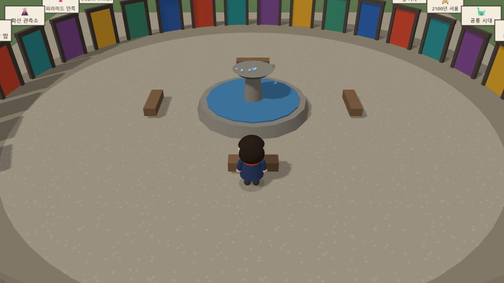

# Nameless World

**A free 3D plaza of small games for Windows.** Stand by a fountain ringed with doors, walk through one, and you are at a late-night street food stall, an Antarctic base, a space station or a Joseon-era market — each a one- or two-minute game. Other players walk around with you. The game is in Korean.

**Install:** download `NamelessWorld.exe` from [Releases](https://github.com/swbins/nameless-world/releases/latest) (Windows 10/11, single file, no installer).

[한국어 설명 ↓](#한국어)

---

## 한국어

**Nameless World — 문을 열면 다른 곳**

분수 광장 둘레에 문이 빙 둘러서 있습니다. 퇴근길 포장마차, 남극 기지, 우주정거장, 조선 장터, 공룡 시대 — 문을 골라 들어가면 장소마다 단추 몇 개로 1~2분이면 끝나는 놀이가 있습니다.

- 장소 서른일곱 곳. 날마다 조금씩 달라집니다.
- 문 위 숫자는 그 안에 지금 있는 사람 수입니다. 다른 사람들도 같이 돌아다니고, 손을 흔들 수 있습니다.
- 새 장소가 생기면 광장에 그대로 붙습니다(내용 업데이트).

## 받기

**[최신 판 받기 (Releases)](https://github.com/swbins/nameless-world/releases/latest)** — `NamelessWorld.exe` 하나, 설치 과정 없음

- **Windows 10 / 11** (창은 Microsoft Edge 로 열립니다 — 기본으로 깔려 있음)
- 처음 실행할 때 **「Windows의 PC 보호」** 창이 뜰 수 있습니다. 코드 서명을 하지 않은 개인 앱이라 그렇습니다.
  **「추가 정보」 → 「실행」** 을 누르면 열립니다.
- 받은 파일 확인(PowerShell): `Get-FileHash .\NamelessWorld.exe` → 릴리스 노트의 SHA256 과 같으면 그대로 받은 것입니다.

## 저장 · 인터넷

- 기록은 **이 PC 안**(`%LOCALAPPDATA%\NamelessWorld`)에만 남습니다. 가입 · 로그인 · 광고 · 사용 통계가 없습니다.
- 인터넷을 쓰는 건 두 가지입니다.
  - **같이 걷기** — 별명(자동으로 붙는 「산책하는 여행자」 같은 이름) · 모습 색 · 위치 · 손 흔들기 같은 동작만 보내고, 장소별 지금 인원 수를 받습니다. 끊겨 있으면 혼자 모드로 그대로 됩니다.
  - **내용 업데이트** — 켤 때 사이트(swbins.github.io)에서 새 장소 · 고친 내용을 확인해 **바뀐 파일만** 받아 둡니다. 다음에 켤 때부터 새 내용이 보입니다.
- 자세한 것은 [개인정보 처리 안내](PRIVACY.md). 지우려면 실행 파일과 위 폴더를 지우면 됩니다.

- [이용 약관](TERMS.md)
- [서드파티 고지](THIRD-PARTY-NOTICES.md)

## 문의 · 버그 알리기

[Issues](https://github.com/swbins/nameless-world/issues) 에 남겨 주세요. 소개 페이지: https://swbins.github.io/nameless-world/

---

이 저장소에는 실행 파일과 안내 문서만 있습니다(소스 비공개).
